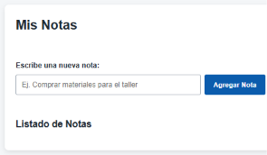

# Auditoría y Rediseño UX - App de Notas

## 1. Tabla de Heurísticas de Nielsen

| Heurística | Problema Identificado | Solución Aplicada |
| :--- | :--- | :--- |
| **1. Visibilidad del estado del sistema** | El usuario no sabía si una nota se agregaba o eliminaba correctamente. | Se añadió un mensaje dinámico visible tras cada acción ("Nota agregada con éxito", "Nota eliminada"). |
| **2. Relación con el mundo real** | Uso de lenguaje poco amigable y controles confusos. | Interfaz simplificada con etiquetas claras y lenguaje directo en botones. |
| **3. Control y libertad del usuario** | La eliminación de notas era inmediata e irreversible. | Se implementó un cuadro de confirmación antes de eliminar cualquier nota. |
| **4. Consistencia y estándares** | Estilos visuales dispersos y sin estructura uniforme. | Uso de variables CSS en `:root`, un solo `<h1>` y espaciado consistente. |
| **5. Prevención de errores** | Se podían enviar notas en blanco a la lista. | Se bloquea la adición si el campo está vacío, mostrando una alerta de prevención. |

---

## 2. Aplicación de Leyes de UX

* **Ley de Fitts:** Los botones de acción principal y eliminación tienen una altura mínima de **44px** para facilitar la interacción táctil y con puntero.
* **Ley de Hick:** Se redujo la complejidad visual manteniendo solo los elementos indispensables: entrada de texto, botón agregar y lista de notas.
* **Ley de Miller:** Las notas agregadas se agrupan en tarjetas individuales para evitar la sobrecarga cognitiva del usuario.

---

## 3. Criterios de Accesibilidad (WCAG)

* **Etiquetas:** Etiqueta `<label>` vinculada explícitamente al campo de texto mediante `for`.
* **Teclado:** Navegación completa posible mediante `Tab` y `Enter` con un foco visible de alto contraste[cite: 16].
* **Contraste:** Colores elegidos con un contraste superior a **4.5:1** entre texto y fondo[cite: 16].
* **Semántica:** Uso estricto de elementos HTML semánticos (`<main>`, `<section>`, `<h1>`, `<ul>`)[cite: 16].

---

## 4. Resultados de Lighthouse

* **Puntaje obtenido:** 100 / 100 en Accesibilidad[cite: 3, 16].

| Captura Antes | Captura Después |
| :---: | :---: |
|  | *[ Pega aquí la captura con puntaje 100 ]* |